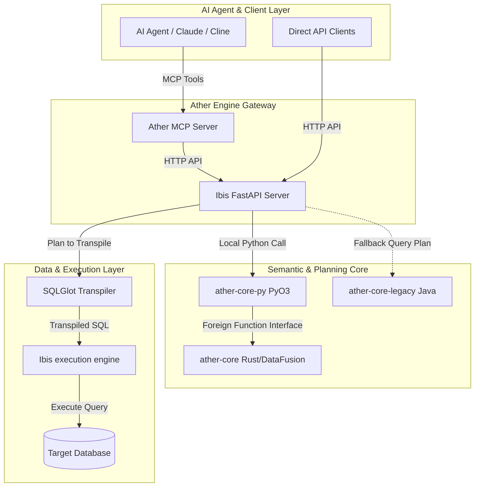

# 🛠️ Ather Engine

[](https://opensource.org/licenses/Apache-2.0)
[](https://www.rust-lang.org/)
[](https://www.python.org/)
[](https://modelcontextprotocol.io/)

**Ather Engine** is a high-performance, lightweight semantic engine and agentic data layer. It acts as an intelligent translator between LLM-generated natural language queries and underlying physical databases. 

By modeling databases semantically using the Metadata Definition Language (MDL), Ather Engine ensures that AI agents query data reliably, securely, and with full context—bridging the gap between raw data schemas and LLM understanding.

---

## ✨ Key Capabilities

* **🔮 Semantic Translation**: Maps complex database schemas into human-readable business concepts using MDL, helping LLMs understand tables and relationships.
* **⚡ High-Performance Planning**: Utilizes a semantic planner built in **Rust** on top of **Apache DataFusion** for lightning-fast query translation and optimization.
* **🔌 Agent-Ready Integration**: Out-of-the-box support for the **Model Context Protocol (MCP)**, allowing agents like Claude Desktop and Cline to query the semantic layer.
* **🌐 Broad Database Compatibility**: Executes planned queries by transpiling via **SQLGlot** and executing via **Ibis**, supporting PostgreSQL, MySQL, DuckDB, BigQuery, Snowflake, and more.

---

## 🏗️ System Architecture

Ather Engine is modular, combining a Rust semantic core, a Python API translation layer, and an MCP gateway:



---

## 📂 Repository Directory & Modules

| Module / Directory | Language | Description |
| :--- | :--- | :--- |
| [**`ather-core`**](./ather-core) | Rust | The high-performance semantic core of the engine. Manages semantic schemas and compiles MDL representations. |
| [**`ather-core-base`**](./ather-core-base) | Rust | Contains shared structures, traits, and utilities for the Rust core. |
| [**`ather-core-py`**](./ather-core-py) | Rust / Python | PyO3-powered bindings that expose `ather-core` features natively to Python. |
| [**`ibis-server`**](./ibis-server) | Python | FastAPI server routing planning requests, utilizing PyO3 bindings and transpiling to physical SQL via Ibis. |
| [**`mcp-server`**](./mcp-server) | Python | Model Context Protocol (MCP) server that packages Ather capabilities as tools for LLMs. |
| [**`ather-core-legacy`**](./ather-core-legacy) | Java | Legacy Trino-parser-based engine core, used as a query-rewriting fallback. |
| [**`example`**](./example) | Docker / Config | Quickstart examples, environments, and testing setups. |

---

## 🚀 Quick Start

### 1. Run the Ibis Server (Docker Compose)
The simplest way to start the engine services is using Docker Compose. Navigate to the `example/` folder or define a `compose.yaml` to spin up the Ibis server and legacy engine:

```yaml
services:
  ibis:
    image: ghcr.io/canner/ather-engine-ibis:latest
    ports:
      - "8000:8000"
    environment:
      - ather_ENGINE_ENDPOINT=http://java-engine:8080
  java-engine:
    image: ghcr.io/canner/ather-engine:latest
    expose:
      - "8080"
```

Start the containers:
```bash
docker compose up -d
```

### 2. Configure and Run the MCP Server
Install [uv](https://docs.astral.sh/uv/) if you haven't already. Then run the MCP server:

```bash
cd mcp-server
uv venv
source .venv/bin/activate  # Or .venv\Scripts\activate on Windows
uv run app/ather.py
```

Provide the necessary environment variables (`ather_URL`, `CONNECTION_INFO_FILE`, and `MDL_PATH`) either via a `.env` file or directly in your system environment. Refer to the [mcp-server README](./mcp-server/README.md) for detailed configuration options.

---

## 🛠️ Developer Guide

### Rust Development (`ather-core`)
To build and test the Rust core components, ensure you have Rust 1.78+ installed:

```bash
cd ather-core
cargo build
cargo test
```

### Python Bindings & API Development
To work on `ather-core-py` or `ibis-server`, we recommend using [Poetry](https://python-poetry.org/) and `just`:

```bash
# Build python bindings
cd ather-core-py
just install
just develop
just test

# Start local ibis FastAPI server
cd ../ibis-server
just install
just run
```

---

## 🛡️ Security Policy

Please read our [SECURITY.md](./SECURITY.md) to learn about supported versions, vulnerability reporting mechanisms, and disclosure policies.

---

## 📄 License

Ather Engine is licensed under the Apache License, Version 2.0. See the [LICENSE](./LICENSE) file for the full text.
